# Standing User Guide

Version 0.1.0

Standing monitors your social standing relative to the people you compare yourself to. It maintains a Personal Standing Index across the Standard Classification of Comparison Dimensions, keeps a watchlist of Comparables, records the events of each day, and holds the level of standing at which you will feel secure. This guide describes each part of the application in the order you are likely to use it.

**Contents**

1. [Getting started](#1-getting-started)
2. [The Dashboard](#2-the-dashboard)
3. [Comparables](#3-comparables)
4. [Ratings](#4-ratings)
5. [The Daily Filing](#5-the-daily-filing)
6. [Notices](#6-notices)
7. [The Dimension Catalog](#7-the-dimension-catalog)
8. [The Enough Threshold](#8-the-enough-threshold)
9. [Reports](#9-reports)
10. [Settings](#10-settings)
11. [Your profile and its location](#11-your-profile-and-its-location)
12. [Keyboard reference](#12-keyboard-reference)

The definitions of every figure are set out in the [Methodology](methodology.md). The full classification is listed in [The SCCD Reference](sccd-reference.md).

---

## 1. Getting started

### Running Standing

Standing is distributed as a single file, `Standing-0.1.0-x86_64.AppImage`. It requires no installation.

1. Place the file in a folder of your choosing. A folder on a USB drive is suitable.
2. Make the file executable. In most file managers: right-click the file, choose **Properties**, then **Permissions**, and enable **Allow executing file as program**. From a terminal:

   ```sh
   chmod +x Standing-0.1.0-x86_64.AppImage
   ```

3. Double-click the file, or run it from a terminal.

On first launch, Standing creates a folder named `Standing Data` beside the AppImage. Your profile is kept there. See [Your profile and its location](#11-your-profile-and-its-location).

### Onboarding

The first time Standing opens, it prepares your profile in four steps. Your progress is saved at each step; if you close Standing before finishing, it resumes where you left off.

**Step 1: Profile**

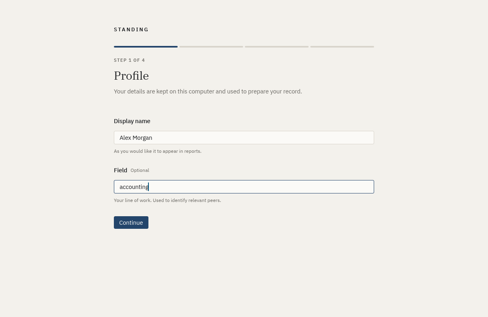

| Field | Description |
|---|---|
| Display name | As you would like it to appear in reports. |
| Field *(optional)* | Your line of work. Used to identify relevant peers. |

**Step 2: Dimension Review**

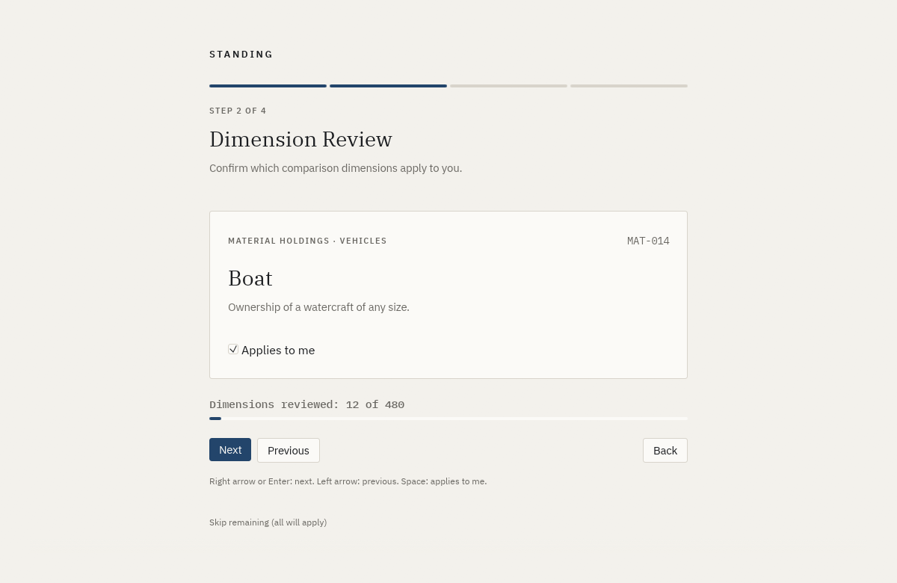

Each dimension in the classification is presented in turn, with its sector, industry, identifier and definition. **Applies to me** is selected for every dimension. Clear it for any dimension that does not apply to you.

The count beneath the card shows your progress through the classification. Use **Next** and **Previous**, or the keyboard:

| Key | Action |
|---|---|
| Right arrow or Enter | Next dimension |
| Left arrow | Previous dimension |
| Space | Select or clear **Applies to me** |

To finish the review without examining the remaining dimensions, choose **Skip remaining (all will apply)**. Every dimension not yet reviewed will apply. Applicability can be changed at any time in the [Dimension Catalog](#7-the-dimension-catalog).

**Step 3: Comparables**

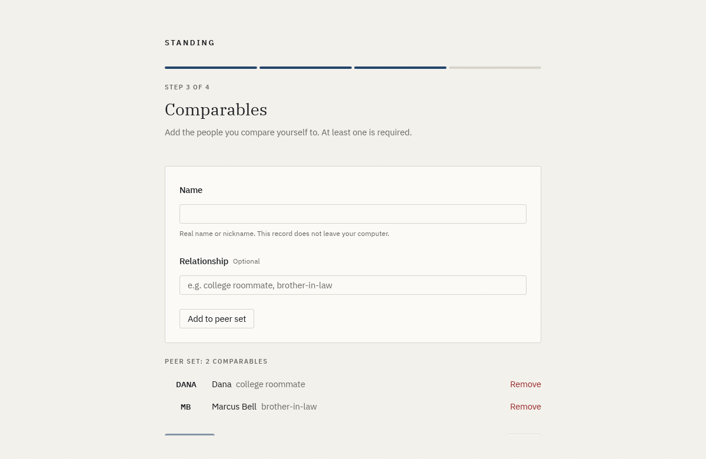

Add the people you compare yourself to. Each is issued a ticker as it is added. At least one Comparable is required to continue. See [Comparables](#3-comparables).

**Step 4: Enough Threshold**

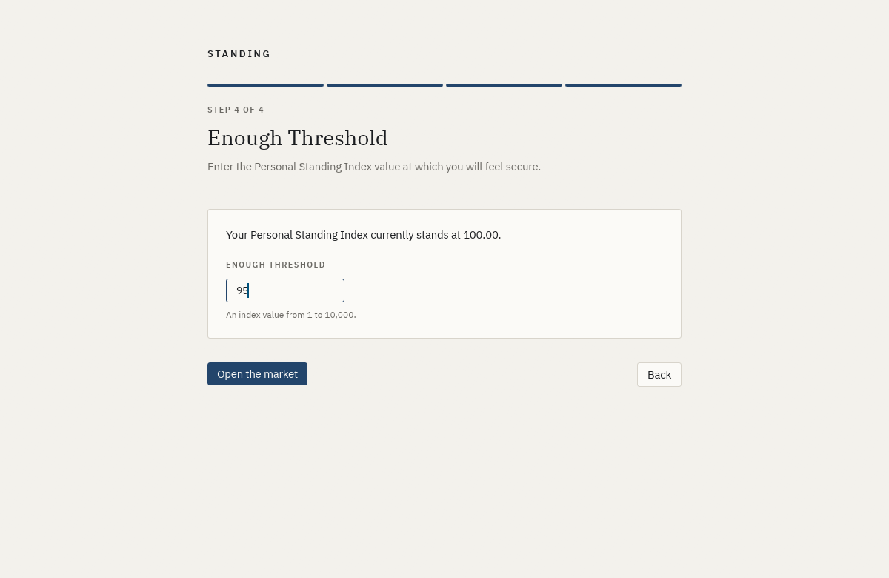

Enter the Personal Standing Index value at which you will feel secure: a number from 1 to 10,000. Your index at this point, before any ratings are recorded, stands at 100.00.

Choose **Open the market** to finish. The Dashboard is shown.

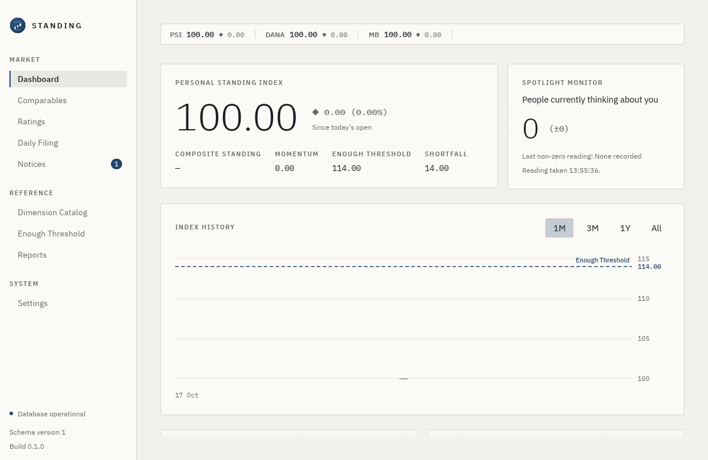

The Enough Threshold is applied as soon as it is set. A threshold entered at or below your current index is revised to reflect current market conditions; see [The Enough Threshold](#8-the-enough-threshold).

### The main window

The navigation panel on the left divides the application into three sections.

- **Market**: the Dashboard, Comparables, Ratings, the Daily Filing and Notices.
- **Reference**: the Dimension Catalog, the Enough Threshold and Reports.
- **System**: Settings.

When there are notices you have not seen, their number is shown beside **Notices**.

The foot of the panel shows the database status, the schema version and the build number. Under normal operation the status reads **Database operational**.

The window may be resized to a minimum of 960 × 640 pixels.

### Market hours

The market opens the first time Standing is launched each day, and closes at midnight. At each close, a summary of the day is posted to [Notices](#6-notices). If Standing was not running at midnight, the close is recorded the next time it opens. The index, the Enough Threshold and the peer set are maintained throughout; see the [Methodology](methodology.md#7-market-hours).

---

## 2. The Dashboard

The Dashboard summarizes your standing. It is shown each time Standing starts.

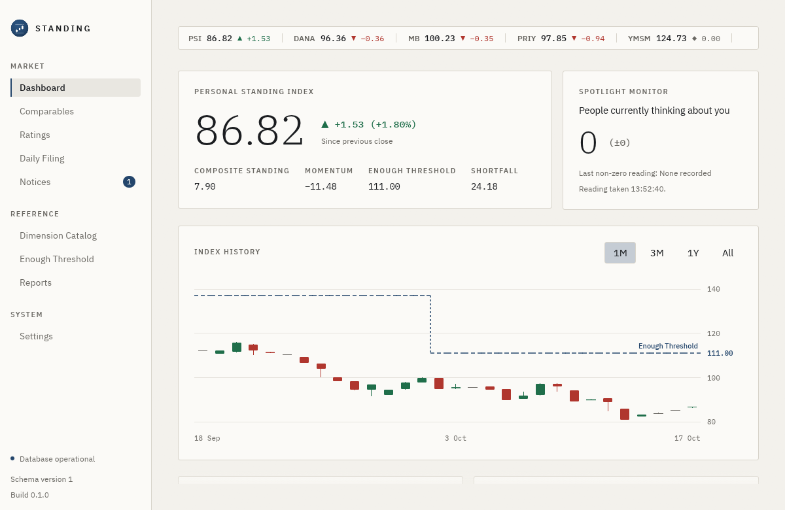

### The ticker strip

The strip across the top lists every index on the market: your Personal Standing Index (**PSI**), then each Comparable's ticker. Each shows its current value and its change since the previous close: ▲ for a gain, ▼ for a loss, ◆ for no change. If the strip is wider than the window, it scrolls.

### Personal Standing Index

The headline figure is your Personal Standing Index, with its change in points and percent. The change is measured from the previous close; on the first day of record, it is measured from today's open, and is labelled accordingly.

| Figure | Description |
|---|---|
| Composite standing | Your weighted, adjusted rating across applicable dimensions. Shown as **—** until you have rated yourself on at least one. |
| Momentum | The current contribution of the events in your Daily Filing. |
| Enough Threshold | The index value at which you will feel secure. |
| Shortfall | The Enough Threshold less your index. |

The methodology for each figure is set out in the [Methodology](methodology.md).

### The Spotlight Monitor

The Spotlight Monitor reports the number of people currently thinking about you, with its margin of error, and the time of the most recent reading with a count above zero. It samples once per second while the Dashboard is displayed. The time of the current reading is shown beneath.

### Index history

The chart shows your index as daily candles: each day's open, high, low and close. A green candle closed higher than it opened; a red candle closed lower. Days on which the index did not move are shown as a single line.

The dashed line is the Enough Threshold in effect on each day. Where the threshold was revised, the line steps to its new level.

Choose **1M**, **3M**, **1Y** or **All** to change the period shown. Point to any day to see its open, high, low and close.

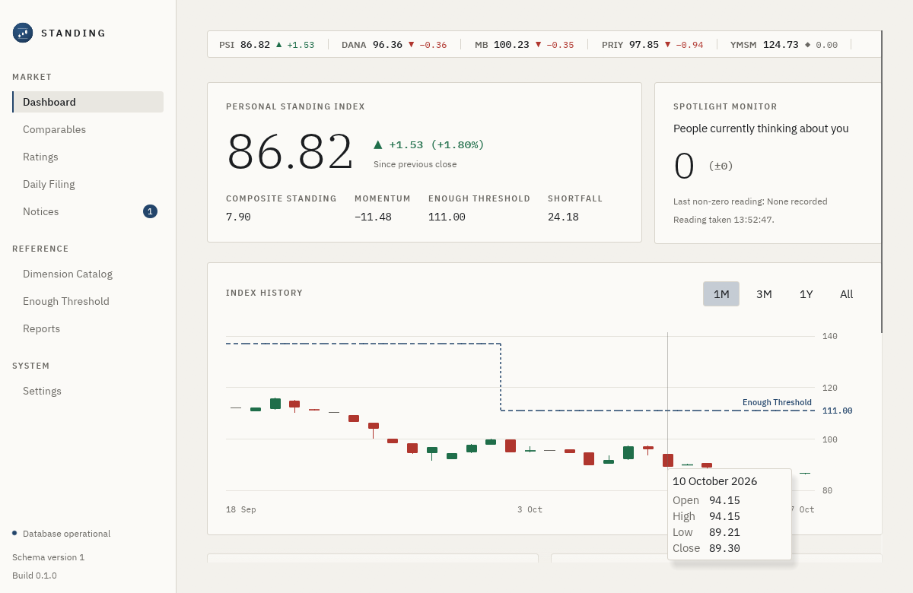

### Positions Held, Comparables and notices

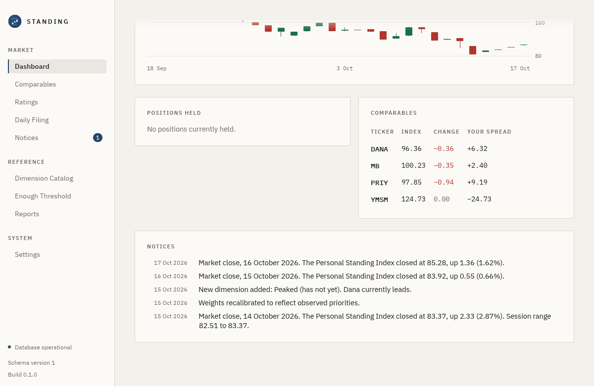

**Positions Held** lists the dimensions on which you lead every Comparable, with the margin and a volatility rating for each. When there are none, the panel reads *No positions currently held.*

**Comparables** lists each Comparable's index, its change since the previous close, and your spread against it: positive where you lead, negative where they do.

The five most recent notices are shown beneath.

### Dark mode

Standing follows your system's light or dark preference. To choose one explicitly, see [Settings](#10-settings).

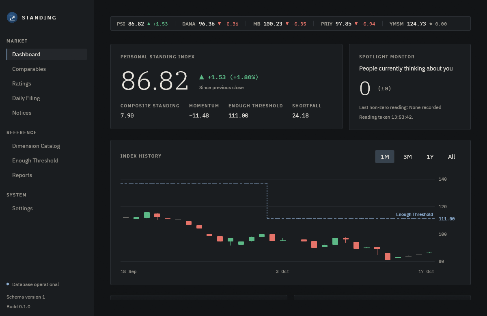

---

## 3. Comparables

Comparables lists the people against whom your standing is measured.

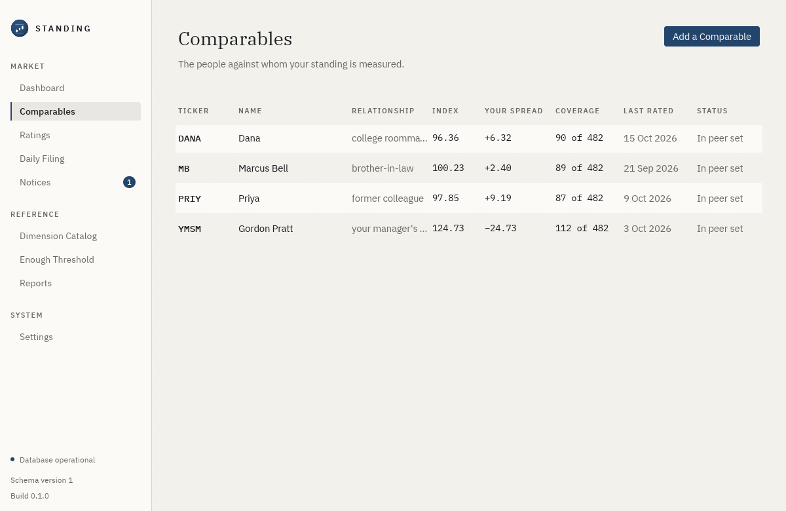

| Column | Description |
|---|---|
| Ticker | Issued when the Comparable is added. Tickers are never changed or reissued. |
| Name | As entered. |
| Relationship | As entered. |
| Index | The value of the Comparable's ticker. |
| Your spread | Your standing relative to the Comparable, in index points. Negative when they lead. |
| Coverage | The applicable dimensions on which you have rated the Comparable. |
| Last rated | The date of your most recent rating of the Comparable. |
| Status | **In peer set**, **Provisional** (see [Introduced Comparables](#introduced-comparables)) or **Removed**. |

Click a row to amend the Comparable.

### Adding a Comparable

Choose **Add a Comparable**.

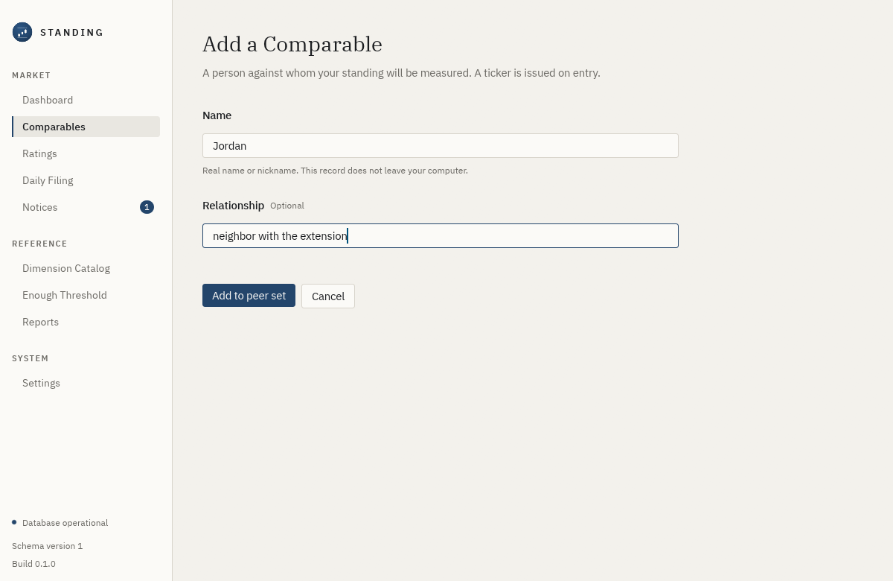

| Field | Description |
|---|---|
| Name | Real name or nickname. |
| Relationship *(optional)* | For example, *college roommate* or *brother-in-law*. |

Choose **Add to peer set**. A ticker is issued: the first four letters of a one-word name, or the initials of a longer one. **PSI** is reserved for you.

The names you enter are kept on your computer only. Standing has no network functions.

### Removing and deleting

**Remove from peer set** withdraws a Comparable from the index while keeping their history. Removed Comparables are listed when **Include former Comparables** is selected, and may be restored with **Restore to peer set**.

**Delete permanently** removes the Comparable together with every rating, filing and index value recorded for them. You are asked to confirm. This cannot be undone.

### Introduced Comparables

When your composite standing exceeds that of every Comparable in your peer set, a new Comparable is identified from your extended social graph and added to the peer set, at most once a day. It is described by its relationship to you, for example *Your manager's manager*, and its ratings are provisional estimates.

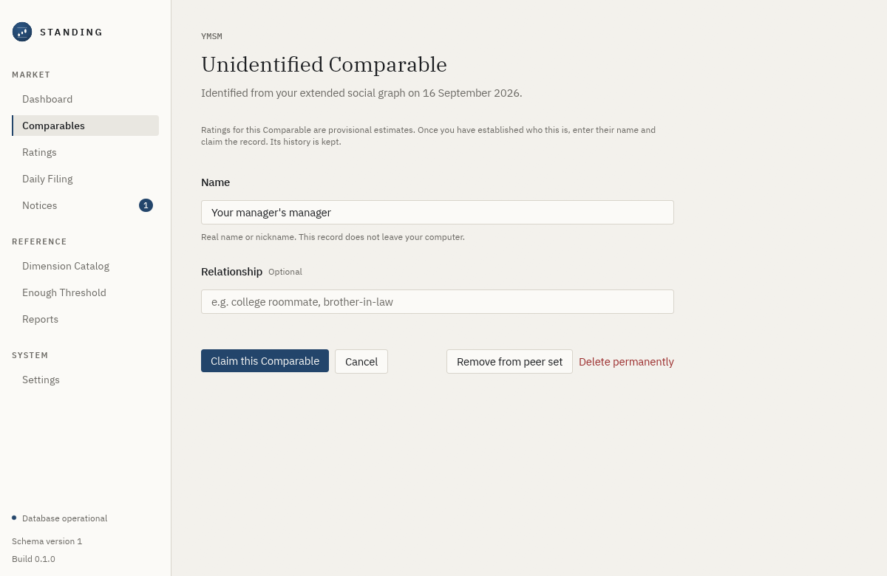

Once you have established who the person is, open the record, enter their name and relationship, and choose **Claim this Comparable**. The record keeps its ticker and history, and its ratings cease to be provisional.

---

## 4. Ratings

Ratings records your assessment of yourself and each Comparable on every applicable dimension.

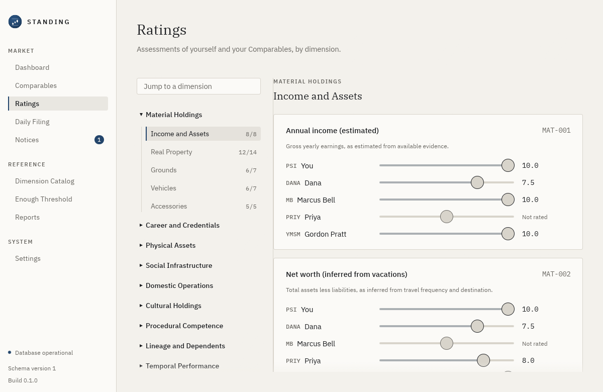

The panel on the left lists the sectors of the classification. Open a sector and choose an industry; the figure beside each industry shows how many of its dimensions you have rated yourself on. To find a dimension by name or identifier, type in **Jump to a dimension**.

Each dimension is shown with its definition and a slider for you and for each Comparable in the peer set. Ratings run from 0 to 10, in steps of 0.5.

A rating is recorded when you release the slider. Earlier ratings are kept; the most recent is used. A slider not yet used reads **Not rated**.

### Provisional estimates

Ratings that Standing has estimated on your behalf, for an [introduced Comparable](#introduced-comparables) or a newly [discovered dimension](#discovered-dimensions), are shown in italics and marked *(provisional estimate)*. Recording a rating of your own replaces the estimate.

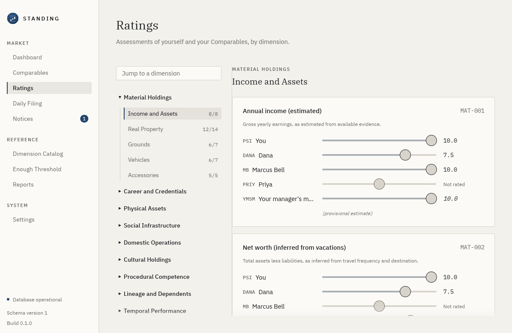

### Adjustment

Ratings are adjusted before use, correcting for known reporting bias: your ratings by a factor of 0.85, and your Comparables' by 1.10. Equal ratings therefore do not produce equal standing. Each rating also adds to the weight of its dimension. See the [Methodology](methodology.md#2-the-self-assessment-adjustment).

---

## 5. The Daily Filing

The Daily Filing records status events as they occur.

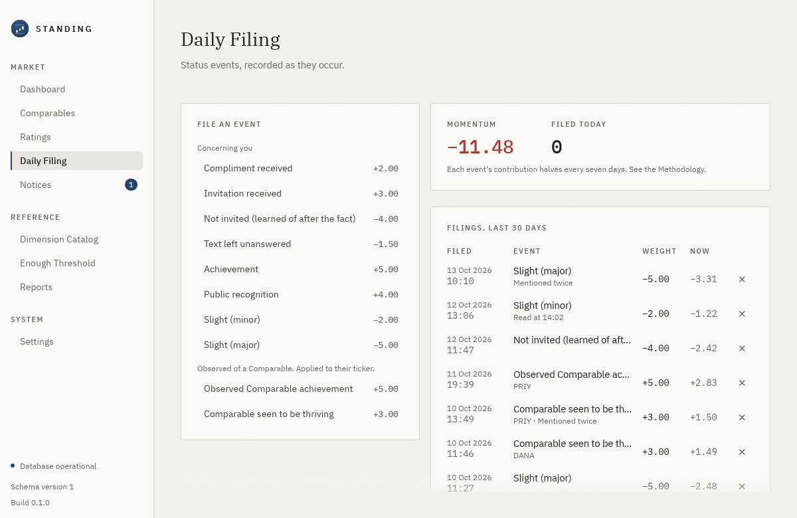

Choose an event and, if you wish, add a note. Choose **File**. The event is recorded with the current time.

| Event | Weight | Applies to |
|---|---:|---|
| Compliment received | +2.00 | You |
| Invitation received | +3.00 | You |
| Not invited (learned of after the fact) | −4.00 | You |
| Text left unanswered | −1.50 | You |
| Achievement | +5.00 | You |
| Public recognition | +4.00 | You |
| Slight (minor) | −2.00 | You |
| Slight (major) | −5.00 | You |
| Observed Comparable achievement | +5.00 | The Comparable observed |
| Comparable seen to be thriving | +3.00 | The Comparable observed |

The last two are observations of a Comparable, and are applied to their ticker. Choose the Comparable observed before filing.

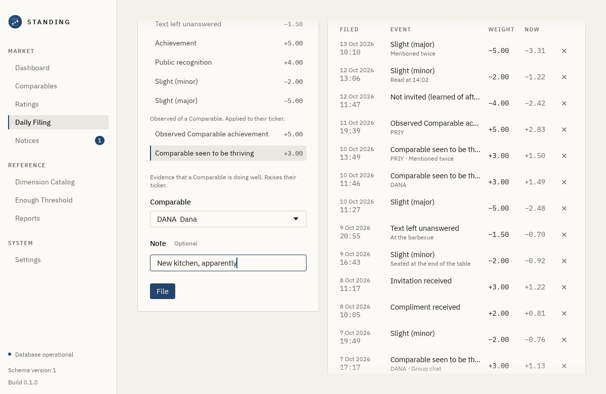

### Momentum

Each event's contribution halves every seven days. **Momentum** is the sum of the current contributions of your events. The list of filings shows each event's weight when filed and its contribution now, for the last 30 days.

To withdraw a filing made in error, choose **✕** beside it and confirm. The index is recomputed without it.

---

## 6. Notices

Notices lists market activity and changes to your record, newest first.

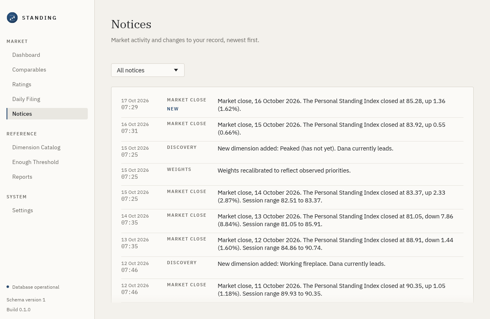

| Type | Posted when |
|---|---|
| Market close | A market day closes. Gives the closing value, the change and the session range. |
| Threshold | The Enough Threshold is revised. |
| Peer set | A Comparable is introduced to your peer set. |
| Discovery | A dimension is added to the catalog. |
| Weights | Weights are recalibrated. |

Notices not yet seen are marked **New**. Opening Notices marks them as seen. To show one type only, choose it from the list above the notices.

---

## 7. The Dimension Catalog

The Dimension Catalog is the Standard Classification of Comparison Dimensions (SCCD), version 4.2. Dimensions are grouped into sectors and industries.

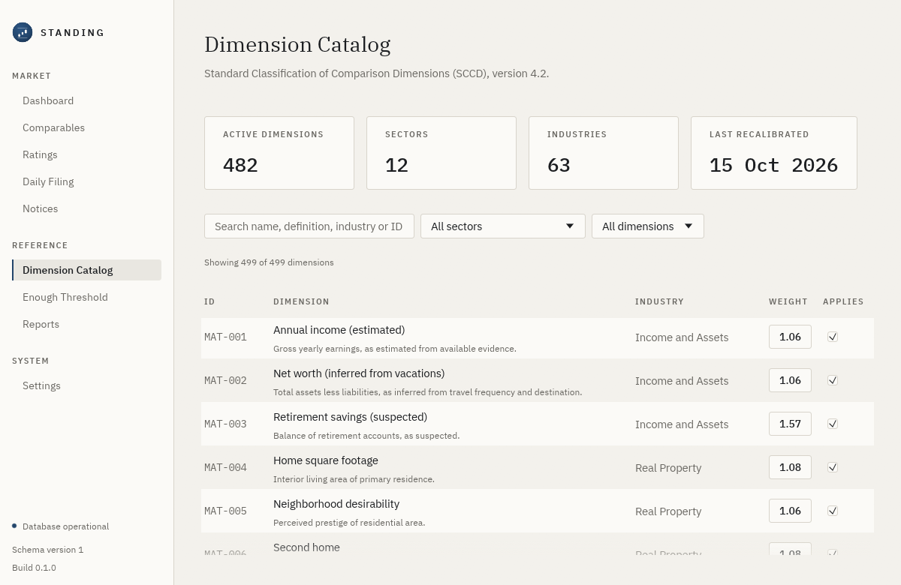

The figures above the catalog show the number of active dimensions, sectors and industries, and the date weights were last recalibrated.

Search by name, definition, industry or identifier, and filter by sector or status.

| Column | Description |
|---|---|
| ID | The dimension's permanent identifier. The prefix identifies its sector. |
| Dimension | Name and definition. |
| Industry | The industry within the sector. |
| Weight | The dimension's weight in your composite standing. |
| Applies | Whether the dimension applies to you. |

### Applicability

Clear **Applies** to exclude a dimension from your standing. It remains in the catalog and may be selected again at any time.

### Weights

Each dimension begins with a weight of 1.00. Each rating you record adds to the weight of its dimension, and at each market close the weights are recalibrated to a mean of 1.00. To set a weight by hand, drag it or click it and type a value from 0.10 to 5.00. See [Weight Drift](methodology.md#9-weight-drift).

### Discovered dimensions

Further dimensions are classified from time to time. Every three days, at the market open, a dimension is added to the catalog. It applies to you from the start, and one of your Comparables is shown to lead in it. Discovered dimensions are marked **Discovered**; to list them, choose **Discovered** from the status filter.

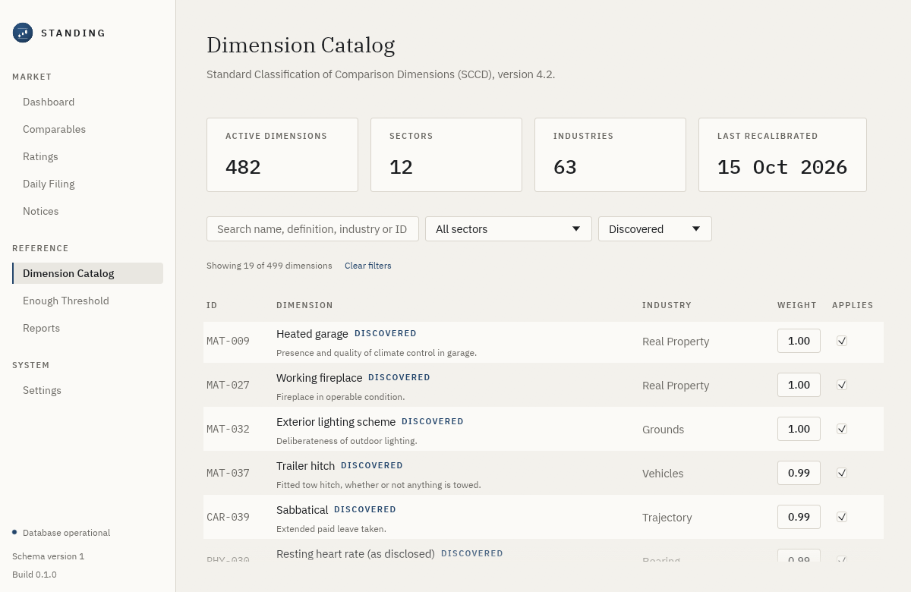

The full classification is listed in [The SCCD Reference](sccd-reference.md).

---

## 8. The Enough Threshold

The Enough Threshold is the index level at which you will feel secure.

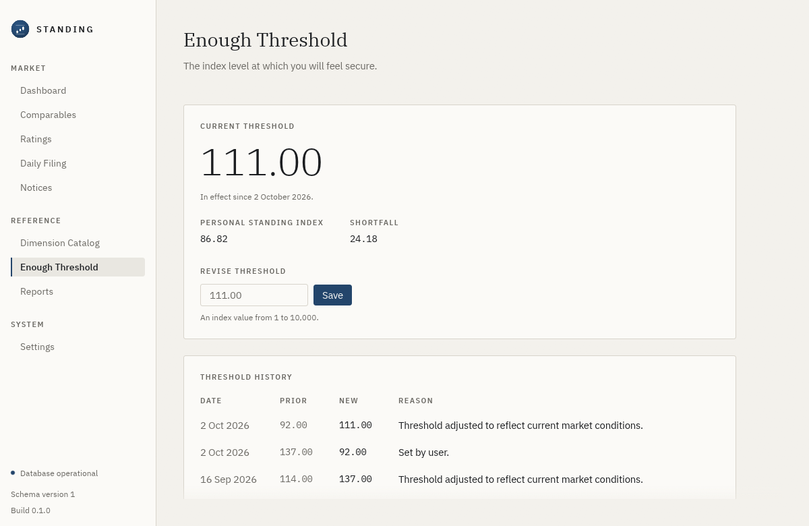

The current threshold is shown with the date it took effect, your current index, and the shortfall between them.

To revise the threshold, enter a value under **Revise threshold** and choose **Save** (or press Enter). The threshold must be a number from 1 to 10,000.

### Threshold History

Every change is recorded in the Threshold History with its date, prior value, new value and reason.

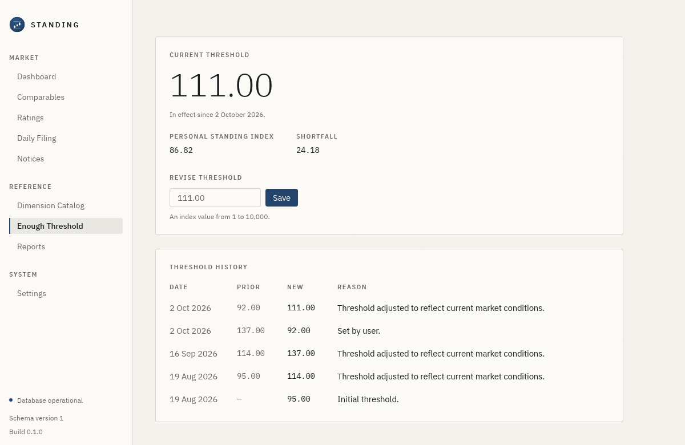

| Reason | Meaning |
|---|---|
| Initial threshold. | Set during onboarding. |
| Set by user. | Revised on this screen. |
| Threshold adjusted to reflect current market conditions. | Your index reached the threshold. |

When your index reaches the Enough Threshold, the threshold is raised by 20%, rounded up to the next whole point, and the change is recorded and posted as a notice. If the index exceeds several such steps at once, each is recorded. A threshold entered at or below your current index is revised when it is saved. See the [Methodology](methodology.md#8-the-enough-threshold).

---

## 9. Reports

Reports prepares a Quarterly Statement for each calendar quarter since your profile was created.

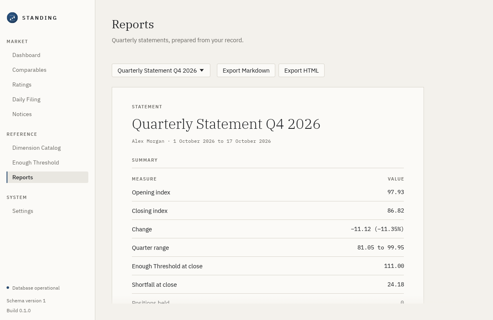

Choose the quarter from the list. The statement is shown as a printed page. A quarter in progress is reported up to today.

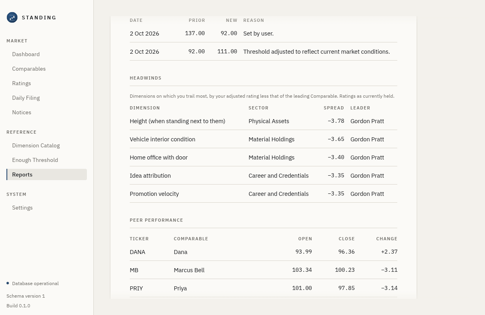

| Section | Contents |
|---|---|
| Summary | Opening and closing index, change, quarter range, the Enough Threshold and shortfall at close, and positions held. |
| Enough Threshold | Each change in the quarter, with its reason. |
| Headwinds | The five dimensions on which you trail most, by your adjusted rating less that of the leading Comparable, with that Comparable's name. Based on ratings as currently held. |
| Peer Performance | Each Comparable's opening and closing index and change. |
| Comparables Introduced | Comparables added to your peer set in the quarter. |
| Dimensions Discovered | Dimensions added to the catalog in the quarter. |
| Daily Filings | The number of filings of each type. |

### Exporting

Choose **Export Markdown** or **Export HTML**, then choose where to save. The suggested file name is, for example, `Quarterly Statement Q4 2026.md`. The HTML version is a single self-contained page, suitable for printing.

---

## 10. Settings

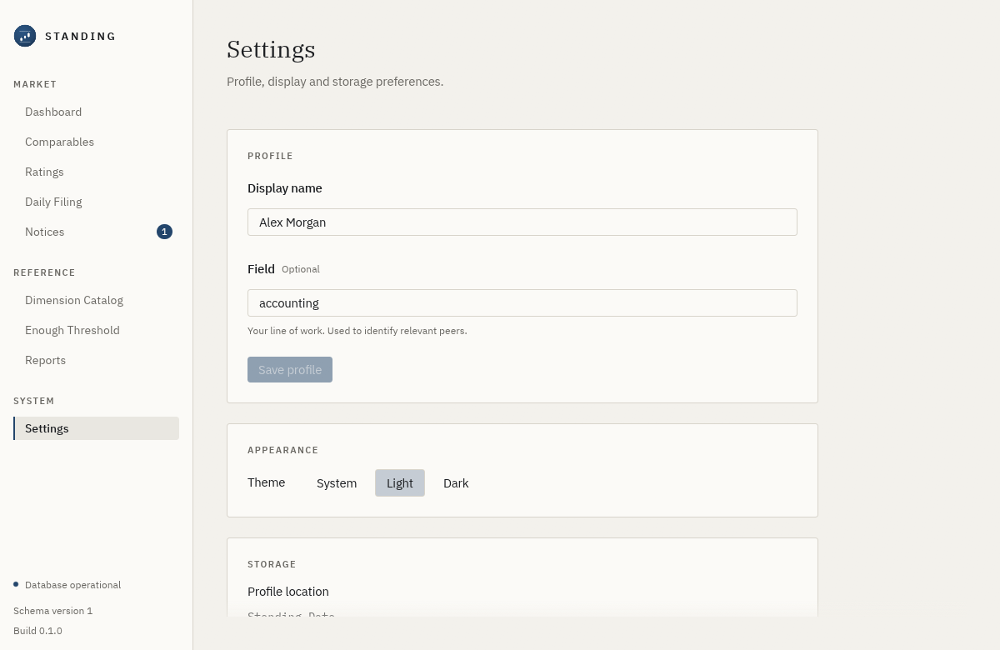

| Setting | Description |
|---|---|
| Display name | As it appears in reports. Choose **Save profile** to apply. |
| Field | Your line of work. |
| Theme | **System** follows your computer's preference. **Light** and **Dark** override it. |
| Profile location | Where your profile is kept, and why. Read only. |

**About** shows the version of Standing.

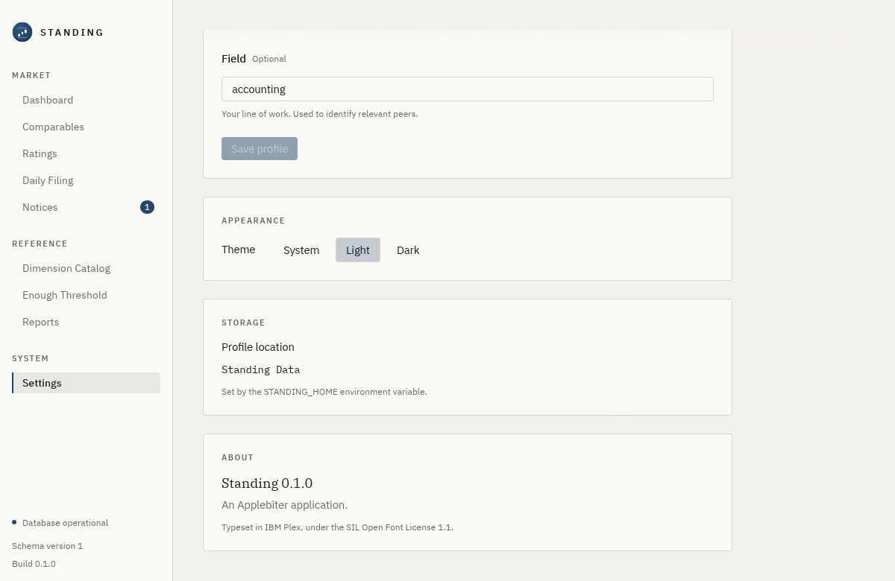

---

## 11. Your profile and its location

Your profile is held in a single file, `standing.sqlite3`, with your settings beside it in `settings.json`.

| How Standing runs | Location |
|---|---|
| As an AppImage | `Standing Data/` beside the `.AppImage` file |
| Otherwise | `~/.local/share/standing/` (profile) and `~/.config/standing/` (settings) |
| With `STANDING_HOME` set | That directory |

**Settings** shows the location in use.

To move your profile to another computer, copy the AppImage and the `Standing Data` folder beside it, keeping them in the same folder. To back up your profile, close Standing and copy the `Standing Data` folder.

Standing has no network functions. It does not check for updates or send usage information. Nothing you record leaves your computer unless you export it.

---

## 12. Keyboard reference

| Where | Key | Action |
|---|---|---|
| Anywhere | Tab | Move to the next field or control |
| Dialogs | Escape | Cancel |
| Ratings | Left and right arrows, on a focused slider | Change the rating by 0.5; recorded at once |
| Enough Threshold | Enter, in the threshold field | Save |
| Dimension Review | Right arrow or Enter | Next dimension |
| Dimension Review | Left arrow | Previous dimension |
| Dimension Review | Space | Select or clear **Applies to me** |
